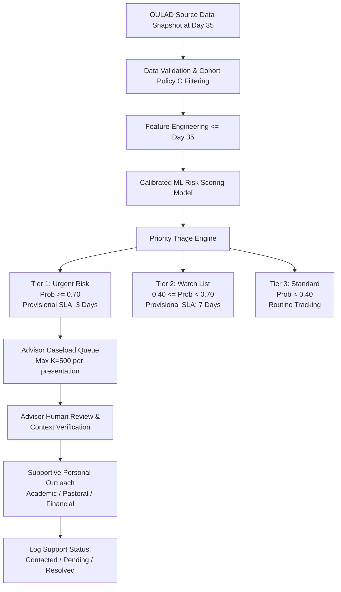

# Business Requirements Document (BRD)

**Project:** Smart Student Retention & Early Warning System
**Phase:** Phase 1 — Business Specification and Data Contract
**Date:** 2026-10-13
**Status:** Proposed Specification (Pending Review)

---

## 1. Business Context & Core Questions

The Smart Student Retention & Early Warning System provides educational decision support by identifying students who show measurable signs of academic risk early in a course presentation.

The system is designed to answer six fundamental business questions:

1. **Who is at elevated risk?** Which enrolled learners have the highest estimated probability of withdrawing from their course module presentation after Day 35?
2. **What behavioral patterns signal risk?** What observable patterns of early Virtual Learning Environment (VLE) engagement and assessment milestone progress are strongly associated with eventual withdrawal?
3. **How should staff prioritize limited capacity?** If advising staff can only conduct outreach to a fixed number of students per term (provisional planning capacity: $K = 500$), which specific cases should be placed at the front of the queue to maximize intervention benefit?
4. **What are the model's limitations and error modes?** Which types of students are falsely flagged (False Positives) or missed (False Negatives), and under what course conditions does the model underperform?
5. **What operational workflow follows an alert?** What structured, supportive outreach steps should an academic advisor take when reviewing a flagged learner?
6. **How can the institution evaluate real impact?** How should the university measure whether proactive advisor outreach actually prevents course withdrawals versus merely observing retrospective correlation?

---

## 2. Target Users & User Personas

### Persona A: Academic Support Advisor ("Elena")
* **Role:** Frontline student support specialist managing caseloads of 300–600 undergraduate learners across STEM and Social Science modules.
* **Goal:** Identify disengaging students during weeks 3–5 to offer study coaching, pastoral guidance, or deadline extension advice before the student drops out.
* **Pain Point:** Currently receives student withdrawal notifications only after the student has formally submitted paperwork or disappeared for 6 weeks, when re-engagement is nearly impossible.
* **System Need:** A clean, sorted triage queue displaying top-risk students, key behavioral drivers (e.g., "0 VLE interactions in past 14 days", "Missed TMA 1 deadline"), and a logged workflow status.

### Persona B: Module Presentation Director ("Dr. Marcus")
* **Role:** Senior faculty member responsible for overall student success, curriculum design, and pass rates in Module `BBB`.
* **Goal:** Understand cohort-wide engagement drop-offs, assess whether specific assignment deadlines trigger spikes in early withdrawal, and monitor advisor intervention volume.
* **Pain Point:** Relies on retrospective end-of-year retention statistics that offer no diagnostic value during the active term.
* **System Need:** Cohort-level dashboard visualising engagement distributions, overall withdrawal prevalence, and priority tier distributions across presentations.

---

## 3. Operational Decision-Support Workflow

The system operationalizes predictive analytics into an actionable, ethical human-in-the-loop workflow:

### 3.1. Provisional Risk Priority Tiers & Service Level Agreements (SLAs)

*Note: All probability thresholds and response SLAs are provisional planning guidelines and must be validated with academic advising leadership prior to deployment.*

| Priority Tier | Provisional Probability Range | Default Caseload % | Provisional Outreach SLA | Prescribed Operational Action |
|---|---|---|---|---|
| **Tier 1 — Urgent** | $\ge 0.70$ (or top 5%) | Top 5%–10% | Within 3 business days | **Direct Personal Outreach:** Phone call or personalized 1-on-1 email from designated academic advisor exploring academic, technical, or personal barriers. |
| **Tier 2 — Watch** | $0.40 \le P < 0.70$ | Next 15%–20% | Within 7 business days | **Nudge & Tutor Check-In:** Automated supportive check-in email with study resources, and notification to module tutor to check in during next seminar/forum. |
| **Tier 3 — Standard** | $< 0.40$ | Remaining ~75% | N/A | **Standard Delivery:** Routine course announcements, automated weekly progress summaries, standard forum moderation. |

### 3.2. Ethical Intervention Principles
1. **Supportive Framing Only:** Outreach communications must NEVER say *"You have been identified by an algorithm as high risk of failure."* Communications must say *"We noticed you haven't been able to log in to the course forum this week and wanted to check in to see how we can assist."*
2. **Human Discretion Prevails:** Advisors may override risk tier assignments based on qualitative context (e.g., student notified tutor of temporary illness or bereavement).
3. **No Automated Penalties:** Predictions must never trigger academic probation, financial aid cuts, or course cancellation.

---

## 4. System Outputs & Deliverables

### 4.1. Tabular Caseload Deliverable (`student_support_queue.csv`)
A structured CSV exported for advising teams containing:
* `student_key`: Pseudonymized student identifier (`id_student`).
* `code_module`, `code_presentation`: Course offering context.
* `prediction_cutoff_day`: Always `35`.
* `risk_probability`: Calibrated probability score ($0.000$–$1.000$).
* `priority_tier`: Tier 1 (Urgent), Tier 2 (Watch), or Tier 3 (Standard).
* `support_reason_summary`: Top 2–3 behavioral factors driving the score (e.g., `days_since_last_vle_click=18; missing_due_submissions_count=1`).
* `review_status`: `Pending`, `Under Review`, `Contacted`, `Resolved`, `No Action Needed`.
* `recommended_next_step`: Specific recommended outreach protocol.

### 4.2. Interactive Streamlit Application
A multi-page dashboard serving:
1. **Operational Overview:** Cohort sizes, withdrawal base rates, priority tier breakdowns.
2. **Engagement Patterns:** Interactive distributions of VLE activity, study patterns, and assessment timeliness by eventual outcome.
3. **Student Support Queue:** Interactive table with module/presentation filtering, sorting by risk score, and export capabilities.
4. **Model Performance:** Comprehensive evaluation metrics (PR-AUC, ROC-AUC, Precision@K, confusion matrix, calibration curve).
5. **Fairness and Limitations:** Disaggregated subgroup metrics, disparate impact ratios, and documented system constraints.

---

## 5. Capacity Constraints & Threshold Policy

Advising departments operate under strict bandwidth constraints:
* **Nominal Outreach Capacity:** Advisors can realistically conduct intensive outreach to approximately **500 students per presentation** (representing ~15%–20% of an average 3,000-student cohort).
* **Threshold Policy:** Rather than enforcing a static probability cutoff (e.g., 0.50), the system evaluates operational utility at configurable capacity cutoffs ($K = 100, 250, 500, 1000$ and top 5%, 10%, 15%, 20%).
* **Performance Metric of Primary Interest:** **Precision@K** and **Recall@K**, ensuring that advisors' limited time is invested in cases that have high true-positive density.
