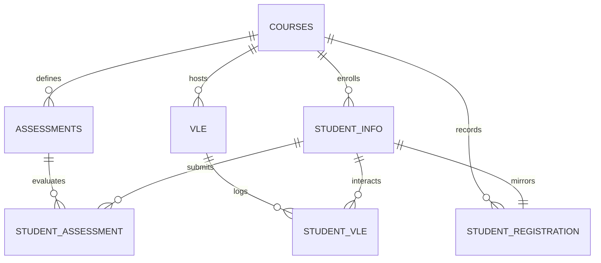

# Entity Relationships & Join Integrity Specification

**Project:** Smart Student Retention & Early Warning System  
**Phase:** Phase 0 — OULAD Workspace and Source Audit  
**Date:** 2026-10-13  
**Status:** Empirically Verified against Source Tables  

---

## 1. Overview of OULAD Entity Architecture

The OULAD relational schema centers on course offerings and student participation instances. 

---

## 2. Table-by-Table Relationship & Cardinality Analysis

### 2.1. `courses` $\rightarrow$ `studentInfo` & `studentRegistration`
* **Parent Table:** `courses.csv` (22 rows, PK: `code_module, code_presentation`)
* **Child Tables:** `studentInfo.csv` (32,593 rows), `studentRegistration.csv` (32,593 rows)
* **Join Key:** `(code_module, code_presentation)`
* **Cardinality:** `1 : N` (Each course presentation enrolls between 365 and 2,498 students).
* **Empirical Integrity Check:**
  * 100% of the 22 presentation pairs in `courses` appear in `studentInfo` and `studentRegistration`.
  * Zero orphan student records exist.

### 2.2. `studentInfo` $\leftrightarrow$ `studentRegistration`
* **Tables:** `studentInfo.csv` vs `studentRegistration.csv`
* **Join Key:** Composite `(code_module, code_presentation, id_student)`
* **Cardinality:** Strict `1 : 1`
* **Empirical Integrity Check:**
  * Both tables contain **exactly 32,593 rows**.
  * Both tables have **0 duplicate keys** on `(code_module, code_presentation, id_student)`.
  * The set difference between the composite keys in both tables is **0 in both directions**.
  * **Conclusion:** These tables can be joined on `(code_module, code_presentation, id_student)` with zero risk of row multiplication or data loss.

### 2.3. `courses` $\rightarrow$ `assessments`
* **Parent Table:** `courses.csv` (22 rows)
* **Child Table:** `assessments.csv` (206 rows, PK: `id_assessment`)
* **Join Key:** `(code_module, code_presentation)`
* **Cardinality:** `1 : N` (Each course presentation defines between 4 and 13 assessments).
* **Empirical Integrity Check:**
  * All 22 course presentations in `assessments` match valid entries in `courses`.

### 2.4. `assessments` $\rightarrow$ `studentAssessment`
* **Parent Table:** `assessments.csv` (206 rows)
* **Child Table:** `studentAssessment.csv` (173,912 rows)
* **Join Key:** `id_assessment`
* **Cardinality:** `1 : N`
* **Empirical Integrity Check:**
  * All 188 distinct `id_assessment` values in `studentAssessment` exist in `assessments.csv`.
  * Exactly 18 assessments defined in `assessments.csv` have zero student submissions. All 18 are of type `Exam` (for modules `AAA`, `BBB`, `EEE`, `FFF`, `GGG` where exams were administered off-platform).
  * Every student in `studentAssessment` exists in `studentInfo`.

### 2.5. `courses` $\rightarrow$ `vle`
* **Parent Table:** `courses.csv` (22 rows)
* **Child Table:** `vle.csv` (6,364 rows, PK: `id_site`)
* **Join Key:** `(code_module, code_presentation)`
* **Cardinality:** `1 : N` (Between 107 and 1,130 VLE materials per presentation).
* **Empirical Integrity Check:**
  * All 6,364 sites belong to one of the 22 valid course presentations.

### 2.6. `vle` $\rightarrow$ `studentVle`
* **Parent Table:** `vle.csv` (6,364 rows)
* **Child Table:** `studentVle.csv` (10,655,280 rows)
* **Join Key:** `id_site`
* **Cardinality:** `1 : N`
* **Empirical Integrity Check:**
  * All 6,268 distinct `id_site` values appearing in `studentVle.csv` exist in `vle.csv`.
  * 96 VLE materials in `vle.csv` had zero student interactions recorded across the entire semester.

---

## 3. High-Risk Join Scenarios & Row Multiplication Traps

Joining relational tables in learning analytics poses severe data inflation risks if grains are not respected:

### Trap 1: Accidental Direct Join between `studentInfo` and `studentVle`
* `studentInfo` has 32,593 rows at grain `(student × course-presentation)`.
* `studentVle` has 10,655,280 rows at grain `(student × course-presentation × site × date)`.
* **Risk:** Joining `studentInfo` directly to `studentVle` inflates the dataset to over 10.6 million rows, destroying student-level statistical integrity and causing massive data duplication.
* **Mandatory Rule:** `studentVle` must NEVER be joined directly to the student cohort table. It must FIRST be temporally filtered (e.g. `date <= 35`) and aggregated to the student-presentation grain (e.g. `total_clicks`, `active_days`, `clicks_per_activity_type`) before joining.

### Trap 2: Direct Join between `studentInfo` and `studentAssessment`
* `studentAssessment` has 173,912 rows. A student typically submits between 1 and 10 assessments over a presentation.
* **Risk:** Joining `studentAssessment` directly produces row multiplication (each student duplicated by their submission count) and introduces future assessment leakage.
* **Mandatory Rule:** Assessment records must be temporally filtered (e.g. `date_submitted <= 35`), aggregated into summary statistics (e.g. `num_submissions_due_window`, `mean_score_window`), and then merged 1:1 onto the cohort table.

---

## 4. Academic Presentation Structures: `B` vs `J` Differences

OULAD courses run twice a year:
1. **`B` Presentations (February start):**
   * Total 9 course offerings (`BBB_2013B`, `BBB_2014B`, `CCC_2014B`, `DDD_2013B`, `DDD_2014B`, `EEE_2014B`, `FFF_2013B`, `FFF_2014B`, `GGG_2014B`).
   * Durations: 234 to 241 days (median: 240 days).
   * Shorter duration, overlapping with Spring/Summer terms.
2. **`J` Presentations (October start):**
   * Total 13 course offerings (covering all 7 modules across 2013J and 2014J).
   * Durations: 261 to 269 days (median: 268 days).
   * Longer duration, standard British academic Autumn start.

**Analytical Implication:**
Day 35 represents $\approx 14.5\%$ of a `B` presentation and $\approx 13.0\%$ of a `J` presentation. The relative operational timing is closely matched, making day 35 a structurally sound common early-warning cutoff across both cycles.

---

## 5. Summary of Join Verification Invariants for Phase 1 Pipeline

1. **Cohort Grain:** The primary prediction dataset must have primary key `(code_module, code_presentation, id_student)`.
2. **Merge Verification:** After joining `studentInfo` and `studentRegistration`, assert `len(df) == 32593`.
3. **Temporal Filtering Invariant:** All child feature joins must assert that no interaction record with `date > cutoff` contributed to feature calculation.
4. **Cardinality Invariant:** Every feature-engineering transformation from `studentVle` and `studentAssessment` must produce exactly 0 or 1 row per student-presentation instance.
