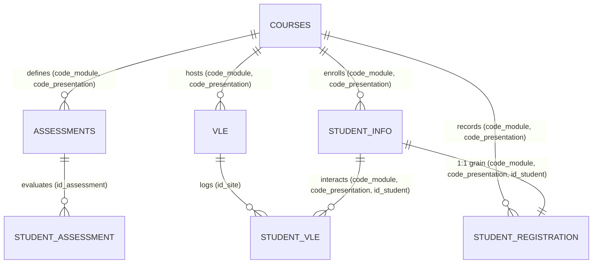

# Entity Relationships & Join Integrity Specification

**Project:** Smart Student Retention & Early Warning System
**Phase:** Phase 0 — OULAD Workspace and Source Audit
**Date:** 2026-10-13 (Updated post-audit verification)
**Status:** Empirically Verified against Source Tables

---

## 1. Overview of OULAD Entity Architecture

The OULAD relational schema centers on course offerings and student participation instances.

*Note on Assessment Linkage:* As shown in the diagram, `STUDENT_ASSESSMENT` does not contain `code_module` or `code_presentation`. It has a strict foreign key relationship to `ASSESSMENTS` on `id_assessment`. Associating student assessment records with the correct course-presentation enrollment requires resolving through `ASSESSMENTS` first.

---

## 2. Table-by-Table Relationship & Cardinality Analysis

### 2.1. `courses` $\rightarrow$ `studentInfo` & `studentRegistration`
* **Parent Table:** `courses.csv` (22 rows, PK: `code_module, code_presentation`)
* **Child Tables:** `studentInfo.csv` (32,593 rows), `studentRegistration.csv` (32,593 rows)
* **Join Key:** `(code_module, code_presentation)`
* **Cardinality:** `1 : N` (Each course presentation enrolls between 365 and 2,498 students).
* **Empirical Integrity Check:**
  * 100% of the 22 presentation pairs in `courses` appear in `studentInfo` and `studentRegistration`.
  * Zero orphan student records exist.

### 2.2. `studentInfo` $\leftrightarrow$ `studentRegistration`
* **Tables:** `studentInfo.csv` vs `studentRegistration.csv`
* **Join Key:** Composite `(code_module, code_presentation, id_student)`
* **Cardinality:** Strict `1 : 1`
* **Empirical Integrity Check:**
  * Both tables contain **exactly 32,593 rows**.
  * Both tables have **0 duplicate keys** on `(code_module, code_presentation, id_student)`.
  * The set difference between the composite keys in both tables is **0 in both directions**.
  * **Conclusion:** These tables can be joined on `(code_module, code_presentation, id_student)` with zero risk of row multiplication or data loss.

### 2.3. `courses` $\rightarrow$ `assessments`
* **Parent Table:** `courses.csv` (22 rows, PK: `code_module, code_presentation`)
* **Child Table:** `assessments.csv` (206 rows, PK: `id_assessment`)
* **Join Key:** `(code_module, code_presentation)`
* **Cardinality:** `1 : N` (Each course presentation defines between 4 and 13 assessments).
* **Empirical Integrity Check:**
  * All 22 course presentations in `assessments` match valid parent entries in `courses`.

### 2.4. `assessments` $\rightarrow$ `studentAssessment` & Safe Join Path to Student Cohort
* **Parent Table:** `assessments.csv` (206 rows, PK: `id_assessment`)
* **Child Table:** `studentAssessment.csv` (173,912 rows, PK: `id_assessment, id_student`)
* **Join Key:** `id_assessment`
* **Cardinality:** `1 : N`
* **Empirical Integrity Check:**
  * All 188 distinct `id_assessment` values in `studentAssessment` exist in `assessments.csv`.
  * Exactly 18 assessments defined in `assessments.csv` have zero student submissions (all 18 are final exams administered offline).

#### The Safe Relational Join Path:
1. `studentAssessment.csv` stores submission records with attributes `id_assessment`, `id_student`, `date_submitted`, `is_banked`, and `score`. Crucially, it **lacks** `code_module` and `code_presentation`.
2. **Step 1:** Join `studentAssessment` to `assessments` on `id_assessment` to retrieve the parent course presentation:
   $$\text{studentAssessment} \bowtie_{\text{id\_assessment}} \text{assessments} \longrightarrow (\text{code\_module}, \text{code\_presentation}, \text{id\_student}, \dots)$$
3. **Step 2:** Now each submission record is contextualized with its correct course offering. Features can be filtered temporally (e.g. `date_submitted <= cutoff`) and aggregated to the student-module-presentation grain.
4. **Step 3:** Merge the aggregated feature records 1:1 onto the student cohort table on the complete primary key `(code_module, code_presentation, id_student)`.

> [!CAUTION]
> **Severe Join Risk — Joining Solely on `id_student`:**
> Across the student population, **3,538 students enrolled in multiple module-presentations** (accounting for 3,136 students whose assessment records span multiple module-presentations). If `studentAssessment` is joined directly to `studentInfo` solely on `id_student`:
> * The join produces **207,319 rows** instead of 173,912 rows (an inflation of **33,407 false rows**).
> * In **33,407 instances**, an assessment submitted in one course presentation is falsely attributed to a different course presentation taken by that same student.
> * Joins must **always** resolve through `assessments.csv` to match on the full composite grain `(code_module, code_presentation, id_student)`.

### 2.5. `courses` $\rightarrow$ `vle`
* **Parent Table:** `courses.csv` (22 rows, PK: `code_module, code_presentation`)
* **Child Table:** `vle.csv` (6,364 rows, PK: `id_site`)
* **Join Key:** `(code_module, code_presentation)`
* **Cardinality:** `1 : N` (Between 107 and 1,130 VLE materials per presentation).
* **Empirical Integrity Check:**
  * All 6,364 sites belong to one of the 22 valid course presentations in `courses`.

### 2.6. `vle` $\rightarrow$ `studentVle`
* **Parent Table:** `vle.csv` (6,364 rows)
* **Child Table:** `studentVle.csv` (10,655,280 rows)
* **Join Key:** `id_site`
* **Cardinality:** `1 : N`
* **Empirical Integrity Check:**
  * All 6,268 distinct `id_site` values appearing in `studentVle.csv` exist in `vle.csv`.
  * 96 VLE materials in `vle.csv` had zero student interactions recorded across the entire semester.

---

## 3. High-Risk Join Scenarios & Row Multiplication Traps

Joining relational tables in learning analytics poses severe data inflation risks if grains are not respected:

### Trap 1: Accidental Direct Join between `studentInfo` and `studentVle`
* `studentInfo` has 32,593 rows at grain `(student × course-presentation)`.
* `studentVle` has 10,655,280 rows at grain `(student × course-presentation × site × date)`.
* **Risk:** Joining `studentInfo` directly to `studentVle` inflates the dataset to over 10.6 million rows, destroying student-level statistical integrity and causing massive data duplication.
* **Mandatory Rule:** `studentVle` must NEVER be joined directly to the student cohort table. It must FIRST be temporally filtered (e.g. `date <= cutoff`) and aggregated to the student-presentation grain (e.g. `total_clicks`, `active_days`, `clicks_per_activity_type`) before joining.

### Trap 2: Direct Join between `studentInfo` and `studentAssessment`
* As detailed in Section 2.4, direct joining on `id_student` without recovering `(code_module, code_presentation)` from `assessments` causes both cross-course Cartesian mismatching (33,407 false pairs) and multi-submission row explosion.
* **Mandatory Rule:** Assessment records must be resolved via `assessments(id_assessment)`, temporally filtered (e.g. `date_submitted <= cutoff`), aggregated into summary statistics (e.g. `num_submissions_due_window`, `mean_score_window`), and then merged 1:1 onto the cohort table.

---

## 4. Academic Presentation Structures & Day-35 Design Hypothesis

OULAD courses run across two distinct presentation cycles:
1. **`B` Presentations (February start):**
   * Total 9 course offerings (`BBB_2013B`, `BBB_2014B`, `CCC_2014B`, `DDD_2013B`, `DDD_2014B`, `EEE_2014B`, `FFF_2013B`, `FFF_2014B`, `GGG_2014B`).
   * Durations: 234 to 241 days (median: 240 days).
   * Overlaps with Spring/Summer terms.
2. **`J` Presentations (October start):**
   * Total 13 course offerings (covering all 7 modules across 2013J and 2014J).
   * Durations: 261 to 269 days (median: 268 days).
   * Standard British academic Autumn start.

### Status of the Day-35 Prediction Cutoff:
* **Initial Design Hypothesis:** Day 35 relative to presentation start was formulated in the project plan (`PROJECT_PLAN.md`) as the primary candidate early-warning window (approximately week 5).
* **Relative Calendar Placement:** Day 35 represents $\approx 14.5\%$ of a `B` presentation and $\approx 13.0\%$ of a `J` presentation. This establishes comparable relative calendar positioning across cohorts.
* **Operational Feasibility Considerations:** Relative calendar percentage alone does **not** prove operational or predictive soundness. Formal justification requires evaluating:
  1. *Early Exit Exclusion:* 5,349 students unregistered $\le$ Day 35 (5,341 Withdrawn + 8 Fail $\le 0$). They departed before early warnings could be operationalized.
  2. *Actionable Target Volume:* 4,812 eventual withdrawals occur after Day 35, providing an adequate target population.
  3. *Information Availability:* 3,253,906 VLE interaction records occur on or before Day 35; however, graded assessment availability at Day 35 is unverified.
* **Phase 1 Mandate:** Day 35 remains an initial working hypothesis until verified against alternative cutoffs (e.g. Day 28 or Day 42) and formally specified in `config/feature_windows.yaml`.

---

## 5. Summary of Join Verification Invariants for Phase 1 Pipeline

1. **Cohort Grain:** The primary prediction dataset must maintain strict primary key `(code_module, code_presentation, id_student)`.
2. **Merge Verification:** After joining `studentInfo` and `studentRegistration`, assert `len(df) == 32593`.
3. **Assessment Resolution:** Always join `studentAssessment` to `assessments` on `id_assessment` before linking to cohort records.
4. **Temporal Filtering Invariant:** All child feature joins must assert that no interaction record with `date > cutoff` contributed to feature calculation.
5. **Cardinality Invariant:** Every feature-engineering transformation from `studentVle` and `studentAssessment` must produce exactly 0 or 1 row per student-presentation instance.
